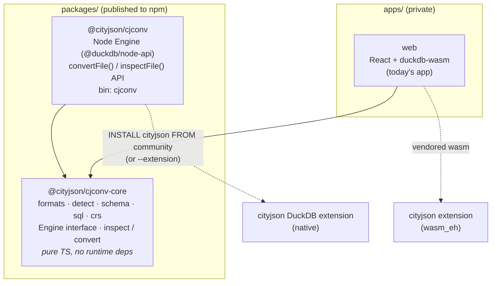

# CLI: proposal

> Status: **approved** (2026-10-11).

The command line does what the web app does — convert between CityJSON, CityJSONSeq,
FlatCityBuf, CityParquet packages and OBJ, choosing LoDs and attributes — with the same
`core` logic. It runs natively (`@duckdb/node-api`), so no browser memory limit applies.
The same packages are later published to npm as a library.

## Example commands

```sh
# Format from the output name
cjconv delft.city.jsonl delft.fcb

# Choose LoDs and attributes
cjconv delft.city.jsonl delft.city.json --lod 2.2 --attributes status,b3_h_dak_max
cjconv delft.city.jsonl delft.city.json --lod 1.2,2.2 --no-attributes

# CityParquet package: a directory (or --to when the name says nothing)
cjconv delft.city.jsonl delft_pkg/ --to cityparquet
cjconv delft_pkg/ delft.city.jsonl

# OBJ: no LoD or CRS in the file, so say what it is
cjconv cube.obj cube.city.jsonl --obj-lod 2.2 --crs EPSG:7415
cjconv delft.city.jsonl out/delft.obj          # writes delft.obj + delft.mtl

# Remote input
cjconv https://cityjson.open3d.city/cityjsonseq/delft.city.jsonl delft.fcb

# What is in a file: format, CRS, LoDs, attributes, object count
cjconv info delft.city.jsonl
cjconv info delft.city.jsonl --json
```

| Option                                    | Meaning                                                                                            |
| ----------------------------------------- | -------------------------------------------------------------------------------------------------- |
| `--to <format>`                           | `cityjson` · `cityjsonseq` · `flatcitybuf` · `cityparquet` · `obj` (default: from the output name) |
| `--from <format>`                         | Override input detection                                                                           |
| `--lod <list>`                            | LoDs to keep (default: all)                                                                        |
| `--attributes <list>` / `--no-attributes` | Attributes to keep (default: all)                                                                  |
| `--obj-lod`, `--crs`                      | For OBJ input                                                                                      |
| `--extension <path>`                      | Load a local `cityjson` build instead of the community one                                         |
| `--force`                                 | Overwrite existing output                                                                          |

## Architecture

The web app's `src/core` already has no React or DuckDB in it (lint enforces that), so
it moves into a package unchanged. That is the extraction `docs/idea.md` planned for
the moment a second consumer appeared.



```
packages/core/   @cityjson/cjconv-core   pure TS core (moved from src/core) + unit tests
packages/cjconv/ @cityjson/cjconv        Node engine, library API, CLI (bin: cjconv)
                                          + the native integration tests (tests/integration today)
apps/web/        private                  the website, unchanged in behaviour
```

- **Library API** (`@cityjson/cjconv`):
  `await convertFile({ input, output, to?, lods?, attributes?, obj? })` and
  `await inspectFile(input)`. The CLI is a thin wrapper over these two functions.
- **Engine.** A native `Engine` over `@duckdb/node-api`. Because DuckDB runs natively,
  it reads and writes files and URLs directly, with no buffer copies. The one difference
  from the web is that a CityParquet output directory has to exist, and the CLI creates it.
- **Extension.** The community `cityjson` build that matches the DuckDB version of
  `@duckdb/node-api` is installed on first use (signed, cached in `~/.duckdb`).
  `--extension` loads a local build instead.
- **Builds.** `vp pack` (tsdown) builds ESM + `.d.ts` for both packages. The web app
  keeps `vp build`.
- **CI.** Unchanged steps, run across the workspace. A future `release.yml` publishes
  the two packages on a version tag.

## Known gaps

- **OBJ needs a newer community build.** The community `cityjson` for DuckDB v1.5.6 is
  `a1455e1`, which has no `read_obj` or OBJ writer. Until community-extensions picks up
  the current `develop`, `cjconv` reports OBJ as unavailable, and `--extension` with a
  local build works around it. Every other format works with the community build today.
- **Platforms.** `@duckdb/node-api` and the community extension cover Linux, macOS and
  Windows (x64 and arm64 where DuckDB ships them).

## Decisions

- Command: `cjconv`.
- npm: `@cityjson/cjconv` (CLI + Node library) and `@cityjson/cjconv-core`, under an
  `@cityjson` npm org that has to exist before the first publish.
- Monorepo now: `packages/core`, `packages/cjconv`, `apps/web`.
