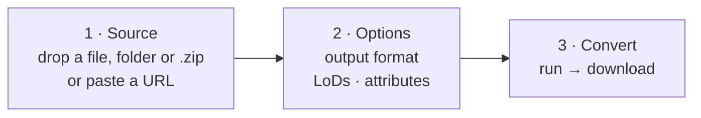
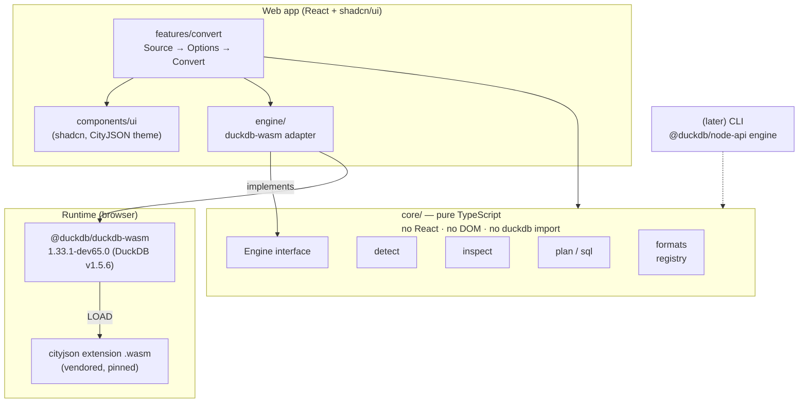
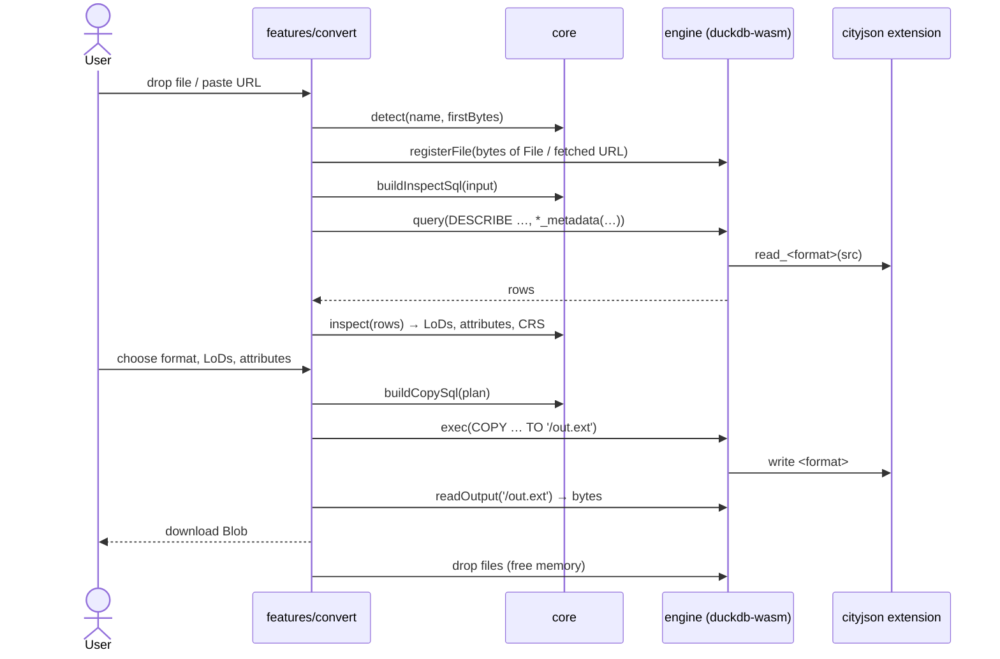
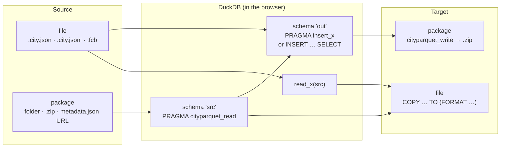
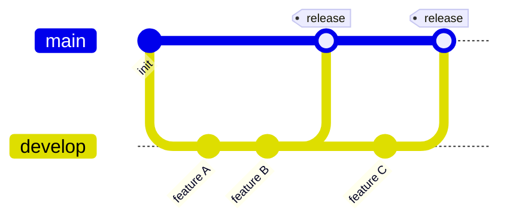
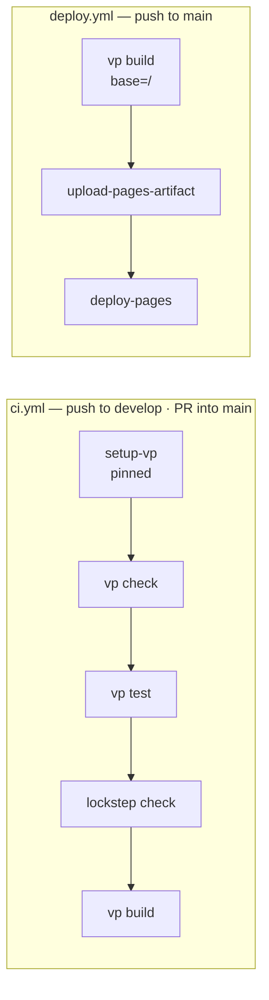
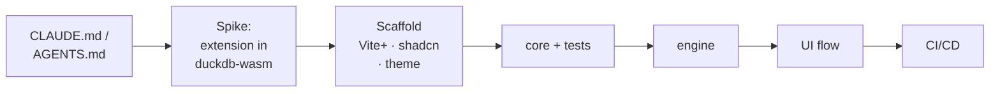

# convert — idea & architecture

> Status: **approved** (2026-10-09).

## 1. Aim

A tool that converts any 3D city model format into another.

| Phase | Formats                                                                                                                                                                                 |
| ----- | --------------------------------------------------------------------------------------------------------------------------------------------------------------------------------------- |
| v1    | CityJSON (`.city.json`), CityJSONSeq (`.city.jsonl`), FlatCityBuf (`.fcb`), OBJ (`.obj` + `.mtl` + textures, zipped on download), CityParquet package (directory; downloaded as `.zip`) |
| later | glTF / GLB (the extension's writer is not yet on DuckDB's file system), CityGML 2.0 / 3.0                                                                                               |

The web app comes first; a CLI comes later.

**Core rule: we write no format readers or writers.** Every read and write is done by the
[`cityjson`](https://github.com/cityjson/duckdb-cityjson) DuckDB extension (and later
[`three_d`](https://github.com/cityjson/duckdb-3d)), running in the browser through duckdb-wasm.
The app only does three things:

1. **inspect** the input,
2. **generate SQL**: a `COPY (SELECT …) TO … (FORMAT …)` for single-file outputs, or the
   extension's `PRAGMA insert_*` → `cityparquet_write` for a CityParquet package,
3. **move bytes** in (drop/URL) and out (download; a package is zipped).

The "later" formats are blocked on extension support, not on this app.

## 2. User experience

One screen, three steps. Nothing else.



- The input format is detected from the file name (`.city.json`, `.city.jsonl`, `.fcb`),
  falling back to sniffing the first KB. The user can override it.
- A **CityParquet package** comes in as a dropped folder or a `.zip`, and is recognised by its
  `*.parquet` module files (`building.parquet`, …) and `metadata.json`. By URL, a package is
  addressed through its `metadata.json` (a STAC Item whose assets list the files).
- LoDs and attributes are discovered from the data, never hard-coded.
- Converting to the same format is allowed (e.g. CityJSON → CityJSON keeping only LoD 2.2).

## 3. Architecture

### 3.1 Dependency diagram



Arrows point in one direction only, and lint enforces it: `core` imports nothing from `engine`,
`features` or React. That boundary is what lets a future CLI reuse `core` unchanged.

| Unit               | Responsibility                                                                               | Depends on                        |
| ------------------ | -------------------------------------------------------------------------------------------- | --------------------------------- |
| `core/formats`     | Registry: id, kind (`file` \| `package`), file extensions, reader, writer, supported options | —                                 |
| `core/detect`      | File name / first bytes → format id                                                          | `formats`                         |
| `core/inspect`     | Turn `DESCRIBE` and `*_metadata()` rows into `{ lods, attributes, crs, version }`            | `formats`                         |
| `core/sql`         | `ConversionPlan` → ordered list of SQL statements                                            | `formats`                         |
| `core/engine`      | `Engine` interface: `query`, `exec` (SQL only)                                               | —                                 |
| `core/convert`     | Orchestrator: `inspect(engine, source)`, `convert(engine, request)`                          | everything in `core`              |
| `engine/`          | duckdb-wasm `Engine`, plus browser I/O: `registerFile`, `readFile`, `dropFiles`, `terminate` | `core`, duckdb-wasm               |
| `features/convert` | The single UI flow and its state                                                             | `core`, `engine`, `components/ui` |
| `components/ui`    | shadcn components, themed with CityJSON tokens                                               | —                                 |

### 3.2 Conversion data flow



### 3.3 The four conversion paths

Every conversion is one of four shapes, depending on whether the source and the target
are a single file or a package:



| Source → target   | SQL                                                                                                                                                                                            |
| ----------------- | ---------------------------------------------------------------------------------------------------------------------------------------------------------------------------------------------- |
| file → file       | `COPY (SELECT … FROM read_x(src, lod => …)) TO out (FORMAT y, metadata_from src)`                                                                                                              |
| file → package    | `CREATE SCHEMA out` · `PRAGMA insert_x('out', src, create_tables = true, lod = …)` · drop unselected attribute columns · `SELECT * FROM cityparquet_write('out', '/out/', source_format => …)` |
| package → file    | `PRAGMA cityparquet_read('/in/', 'src')` · `COPY (SELECT … FROM src.building UNION ALL BY NAME …) TO out (FORMAT y, crs …)`                                                                    |
| package → package | `cityparquet_read` · keep selected columns · `cityparquet_write`                                                                                                                               |

A package output is a directory (`building.parquet`, …, `metadata.json`), so the engine reads
every file under `/out/` and the UI zips them into one download.

### 3.4 Single-file SQL shape

The single-file SQL has this shape:

```sql
COPY (
  SELECT id, feature_id, object_type, children, children_roles, parents, address, template, other,
         <kept attribute columns>,
         <geometry / properties / material / texture columns>, bbox
  FROM read_cityjsonseq('<src>')
) TO '/out.city.json' (FORMAT cityjson, metadata_from '<src>');
```

Selection rules:

- **LoD** filtering keeps only the chosen `geometry*_lodX_Y` / `material_lodX_Y` / `texture_lodX_Y`
  column groups. The reader's `lod =>` takes only one LoD, so it's just an optimisation for the
  single-LoD case.
- **Attribute** filtering only removes attribute columns. The core columns (`id`,
  `feature_id`, `object_type`, hierarchy, geometry, property, material and texture
  columns, `bbox`) are always kept.
- `metadata_from` is always passed for a file source, so CRS, metadata and appearance carry
  over without depending on the extension inferring the source. For a package source the CRS
  comes from the package footer (`__cityparquet.city`) and is passed as `crs`.

## 4. Technology

| Concern    | Choice                                                                                                                                                                                                                                                                                                                                                                                                     |
| ---------- | ---------------------------------------------------------------------------------------------------------------------------------------------------------------------------------------------------------------------------------------------------------------------------------------------------------------------------------------------------------------------------------------------------------- |
| UI         | React + TypeScript, shadcn/ui (Tailwind)                                                                                                                                                                                                                                                                                                                                                                   |
| Toolchain  | Vite+ (`vp dev` · `vp build` · `vp test` · `vp check` = lint + fmt + types)                                                                                                                                                                                                                                                                                                                                |
| Engine     | `@duckdb/duckdb-wasm` **pinned exactly** to `1.33.1-dev65.0` (DuckDB v1.5.6), eh bundle, served from our own build, loaded lazily on first use                                                                                                                                                                                                                                                             |
| Extensions | `cityjson` and `parquet` `wasm_eh` builds for DuckDB v1.5.6, **vendored** under `public/duckdb-ext/v1.5.6/wasm_eh/` and loaded through `custom_extension_repository`. `parquet` is the official signed build. `cityjson` is self-built from duckdb-cityjson `e43c986` (wasm I/O fixes, OBJ writer), so it is unsigned until the community repository publishes it. See [spike-findings](spike-findings.md) |
| Hosting    | GitHub Pages, custom domain `convert.cityjson.org`, `base: '/'`                                                                                                                                                                                                                                                                                                                                            |

**Version lockstep.** duckdb-wasm rejects any extension whose DuckDB version footer does not
match its own. The duckdb-wasm npm pin and the vendored extension directory must always move
together, and CI checks this.

### Theme — CityJSON design system

The colors come from the CityJSON design system. They map onto shadcn's CSS variables, so
every component picks them up automatically.

| shadcn variable              | CityJSON token                | Value                                                   |
| ---------------------------- | ----------------------------- | ------------------------------------------------------- |
| `--primary`                  | `--purple-100` (btn-primary)  | `#5e41d0`                                               |
| link / ring                  | `--purple-000`                | `#7253ed`                                               |
| `--foreground`               | `--grey-dk-100` (body text)   | `#5c5962`                                               |
| headings                     | `--grey-dk-300`               | `#27262b`                                               |
| `--background`               | `--white`                     | `#ffffff`                                               |
| `--muted` / sidebar          | `--grey-lt-000`               | `#f5f6fa`                                               |
| `--border` / `--input`       | `--grey-lt-100`               | `#eeebee`                                               |
| `--destructive`              | `--red-300`                   | `#dd2e2e`                                               |
| brand accents (format chips) | house / block / tree          | `#6449d6` / `#f5aa00` / `#7ca12b`                       |
| `--radius`                   | `--border-radius`             | `4px`                                                   |
| shadow                       | `--shadow-1`                  | `0 1px 2px rgba(0,0,0,.12), 0 3px 10px rgba(0,0,0,.08)` |
| font                         | `--font-sans` / `--font-mono` | system UI stack, no webfont                             |

The theme is light-only, matching cityjson.org.

## 5. Folder structure

```
/
├─ src/
│  ├─ core/               pure logic, Engine interface, orchestrator   (unit-tested)
│  ├─ engine/             duckdb-wasm implementation + browser file I/O
│  ├─ features/convert/   the one UI flow (Source → Options → Convert)
│  ├─ components/ui/      shadcn components
│  ├─ lib/utils.ts        shadcn `cn` helper
│  ├─ assets/             CityJSON logo
│  ├─ styles/theme.css    CityJSON tokens → shadcn variables
│  └─ main.tsx, App.tsx
├─ public/duckdb-ext/     manifest.json + v1.5.6/wasm_eh/ vendored extension binaries
├─ scripts/               vendor-extensions, check-lockstep
├─ tests/
│  ├─ fixtures/           20-feature 3DBAG Delft subset
│  ├─ integration/        core against native DuckDB + cityjson
│  ├─ browser/            duckdb-wasm smoke test (headless Chromium)
│  └─ support/            native Engine for tests
├─ docs/                  this file + spike findings
├─ .github/workflows/     ci.yml, deploy.yml
├─ CLAUDE.md
└─ AGENTS.md -> CLAUDE.md
```

**Why one app and not a monorepo:** there is only one consumer today. A CLI can already be
`duckdb -c "LOAD cityjson; COPY …"`. Keeping `src/core` free of React and DuckDB, with lint
enforcing it, means it can become `packages/core` in a single move once a second consumer
exists.

## 6. Branches and CI/CD

Two long-lived branches:

| Branch    | Role                                     | Pushing                               |
| --------- | ---------------------------------------- | ------------------------------------- |
| `develop` | Integration branch for day-to-day work   | Push freely                           |
| `main`    | Release branch; every commit is deployed | Only by merging `develop` into `main` |





A release is a PR from `develop` into `main`. CI must pass before it merges, and the merge
triggers the deploy.

`deploy.yml` is written now but only succeeds once GitHub Pages is enabled. The repo is
private, so that needs either a public repo or a paid org plan, which is still to be decided.

## 7. Testing

| Level         | What                                                                                                                          | How                                                              |
| ------------- | ----------------------------------------------------------------------------------------------------------------------------- | ---------------------------------------------------------------- |
| Unit          | `core`: detect, inspect parsing, SQL builder                                                                                  | Vitest (`vp test`)                                               |
| Integration   | Generated SQL against the real `cityjson` extension                                                                           | Vitest + `@duckdb/node-api` (native DuckDB, no wasm workarounds) |
| Browser smoke | Real duckdb-wasm + vendored extension, in headless Chromium: versions, inspect, package write. Known wasm bugs are `it.fails` | Vitest Browser Mode (Playwright provider)                        |

The browser smoke test is the one that catches a duckdb-wasm and extension version mismatch.

## 8. Limits and risks

| Risk                                                                                                                                                                       | Mitigation                                                                                                                                         |
| -------------------------------------------------------------------------------------------------------------------------------------------------------------------------- | -------------------------------------------------------------------------------------------------------------------------------------------------- |
| Extension wasm I/O bugs (writers, HTTP reads, file handles, package reads)                                                                                                 | Fixed upstream in duckdb-cityjson#23 and vendored as a self-built `e43c986`. Browser tests guard each one. See [spike-findings](spike-findings.md) |
| Memory: inputs are registered with `registerFileBuffer` (file handles hang, bug 3), so the input is held in memory too, and the output is copied (wasm FS → buffer → Blob) | State a practical limit of a few hundred MB; switch to file handles once bug 3 is fixed; OPFS later                                                |
| `DESCRIBE` cost                                                                                                                                                            | Measured: 0.17 s for 6.6 MB natively, so it's cheap. `*_metadata()` does not list LoDs, so `DESCRIBE` is required                                  |
| No COOP/COEP on Pages → no wasm threads                                                                                                                                    | Single-threaded eh bundle                                                                                                                          |
| Pasted URLs without CORS                                                                                                                                                   | Show a clear error, not a spinner                                                                                                                  |
| `cityparquet_read` needs a real directory (bug 4)                                                                                                                          | Upstream fix; until then, load each module file with `read_parquet` + `cityparquet_init` and pass the footer's CRS explicitly                      |
| Package creation needs a seeded object table                                                                                                                               | Seed `building` with `LIMIT 0` of the source, then `cityparquet_init`, then `insert_*`, each as its own statement                                  |
| Package → file CRS                                                                                                                                                         | Verified: take the EPSG id from the footer's PROJJSON (`cityparquet_city_field(city, 'crs')`) and pass it as `crs`                                 |
| A new DuckDB release breaks the lockstep                                                                                                                                   | Pin both versions together, check in CI, update deliberately                                                                                       |
| Dropping LoDs on the way into a package leaves `bbox` spanning the removed geometry (no `cityparquet_reconcile`)                                                           | Known, not wrong: containment holds, the box is just wider than a fresh read. Revisit if consumers rely on tight boxes                             |

## 9. Build order



The spike is throwaway: it answers whether each reader and writer works in the browser, and
its code is not kept.
